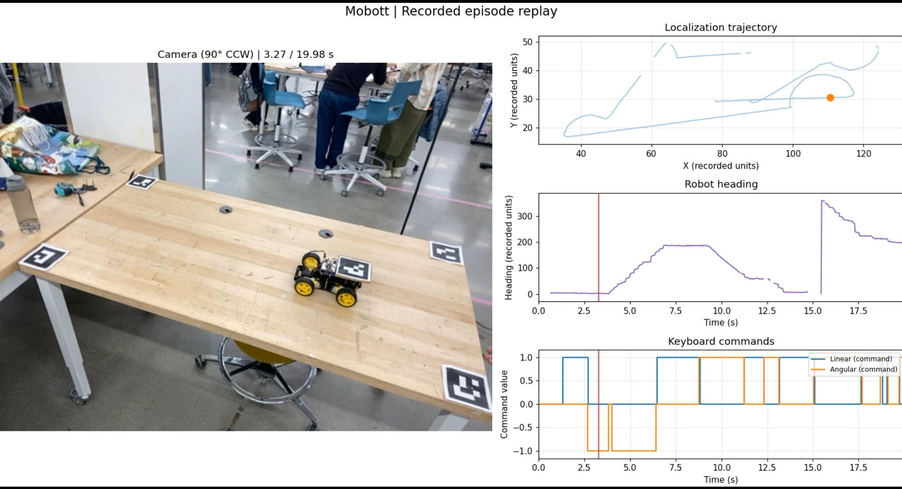

# Mobott 🤖

**A low-cost, open-source mobile robotics experimentation platform.**

Mobott is a small ESP32-powered mobile robot designed to make real-world robotics experimentation more accessible.

Using a ~$50 robot, a smartphone camera, and a computer, we're building a platform for exploring **perception, localization, navigation, control, and robot learning**.

The goal is simple: **spend less time building experimental infrastructure and more time testing robotics ideas.**

## What's Working

- **Robot Control:** Manual teleoperation and ESP32 communication over Wi-Fi.
- **Perception & Localization:** Camera streaming through ROS 2, marker-based localization, and experimental perception pipelines.
- **Episode Recording:** Configurable ROS 2 recording sessions with sensor validation and metadata.
- **Experiment Analysis:** Synchronized playback of camera footage, robot pose, and control commands.

Our latest experiment captured **1,305 ROS messages in 20 seconds** across camera, localization, and control streams.

## Experiments & Demos

### Episode Recording & Replay

Record synchronized camera observations, robot localization, and control commands. Replay experiments to investigate robot behavior and analyze performance.

### Autonomous Goal Navigation

Navigate toward target positions on a tabletop using camera-based localization and motion planning.

## What's Next

- Dataset validation and timestamp synchronization
- Behavior cloning for goal navigation and object pushing
- Simulation integration and policy evaluation
- IMU integration and multi-sensor fusion

## Explore the Code

| Component | Directory |
|---|---|
| ESP32 firmware | [robot/](robot/) |
| ROS 2 modules | [ros2/](ros2/) |
| Robot control | [mobott_control/](mobott_control/) |
| Episode recording and replay | [mobott_episode_recorder/](mobott_episode_recorder/) |
| ESP32 communication | [mobott_telemetry/](mobott_telemetry/) |
| Tabletop experiments | [tabletop_acebott/](tabletop_acebott/) |

### Documentation

- [Person Following: Setup and Experiments](docs/person-following.md)

More setup guides and experiment documentation are being developed.

## Contribute

We're looking for **students, researchers, and robotics enthusiasts** interested in building and learning together.

Whether you're interested in robotics software, perception, controls, machine learning, or hardware, contributions and new experimental ideas are welcome.

**Interested?** Open a GitHub issue or reach out to [Shyam Sreenivasan](https://github.com/shyam-sreenivasan).

*Mobott is an evolving experimental platform. Documentation and setup instructions are being updated as the project develops.*

