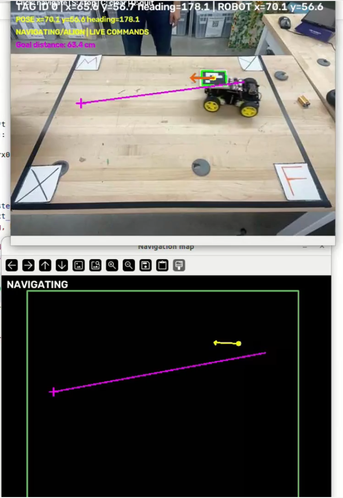

# Mobott 🤖

**A low-cost, open-source mobile robotics experimentation platform.**

Mobott is an ESP32-powered mobile robot for exploring real-world **perception, localization, navigation, control, and robot learning**.

Using a ~$50 robot, a smartphone, and a computer, we're building a platform that makes physical robotics experimentation more accessible.

**Our goal:** Spend less time building infrastructure and more time experimenting with robotics.

## Architecture

Mobott follows a distributed architecture, separating sensing, computation, and physical control.

```text
   Smartphone                  Computer
   ┌────────────┐         ┌──────────────────────┐
   │ Camera     │         │ ROS 2                │
   │ IMU        │────────▶│ Perception           │
   │ Sensors    │         │ Localization         │
   └────────────┘         │ Planning & Control   │
                          │ Episode Recording    │
                          │ Analysis & Learning  │
                          └──────────┬───────────┘
                                     │ Wi-Fi
                                     ▼
                              ┌────────────┐
                              │ ESP32      │
                              │ Motor      │
                              │ Controller │
                              └────────────┘
                                   Mobott
```

### Architecture Choices

Mobott separates two independent architectural decisions:

**1. Sensor Placement**
- **External sensing:** Smartphone camera and sensors positioned around the workspace.
- **Onboard sensing:** Robot-mounted cameras, IMUs, and other sensors that move with the robot.

**2. Compute Placement**
- **Offboard computing:** A PC runs perception, localization, planning, and learning algorithms.
- **Onboard computing:** An embedded processor handles some or all computation locally.

Our current implementation primarily uses **external sensing with offboard computing**, keeping the robot inexpensive and easy to modify.

Future configurations can mix these approaches, such as a robot-mounted camera streaming to a PC.

This flexibility allows researchers to investigate tradeoffs in **cost, latency, power consumption, sensing coverage, and autonomy** without rebuilding the entire platform.

### Why this architecture?

- **Low cost:** No onboard Raspberry Pi, GPU, or dedicated compute module required.
- **Accessible hardware:** Reuse a smartphone's camera and sensors.
- **Flexible experimentation:** Run and modify algorithms on a computer without changing robot hardware.
- **Modular:** Replace or extend perception, localization, planning, and control components independently.
- **Observability:** Record sensor observations, state estimates, and control commands using ROS 2.

The tradeoff is dependence on network connectivity, communication latency, and offboard computation. Understanding these limitations is itself an important part of our experiments.

## What's Working

- **Robot Control:** Manual teleoperation and ESP32 communication over Wi-Fi.
- **Perception & Localization:** Smartphone camera streaming through ROS 2 and marker-based localization.
- **Episode Recording:** Configurable sessions with stream validation, metadata, and ROS 2 data capture.
- **Experiment Analysis:** Synchronized playback of camera footage, robot pose, and control commands.

In a recent 20-second experiment, we captured **1,305 ROS messages**, including camera frames at ~30 Hz, localization at ~16 Hz, and control commands at ~20 Hz.

## Experiments & Demos

### Episode Recording & Replay

A unified view of camera observations, localization estimates, and control commands for investigating robot behavior.


### Autonomous Goal Navigation

Camera-based localization and motion planning for navigating toward target positions on a tabletop.



## What's Next

- Dataset validation and timestamp synchronization
- Behavior cloning for goal navigation and object pushing
- Simulation integration and policy evaluation
- IMU integration and sensor fusion
- Onboard sensing and alternative hardware configurations

## Explore the Code

| Component | Directory |
|---|---|
| ESP32 firmware | [robot/](robot/) |
| ROS 2 modules | [ros2/](ros2/) |
| Robot control | [mobott_control/](mobott_control/) |
| Episode recording and replay | [mobott_episode_recorder/](mobott_episode_recorder/) |
| ESP32 communication | [mobott_telemetry/](mobott_telemetry/) |
| Tabletop experiments | [tabletop_acebott/](tabletop_acebott/) |

## Contribute

We're looking for **students, researchers, and robotics enthusiasts** interested in building and learning together.

Contributions in robotics software, perception, controls, machine learning, hardware, and experimental design are welcome.

**Interested?** Open a GitHub issue or reach out to [Shyam Sreenivasan](https://github.com/shyam-sreenivasan).

*Mobott is an evolving experimental platform. Documentation and setup instructions are being updated as the project develops.*
